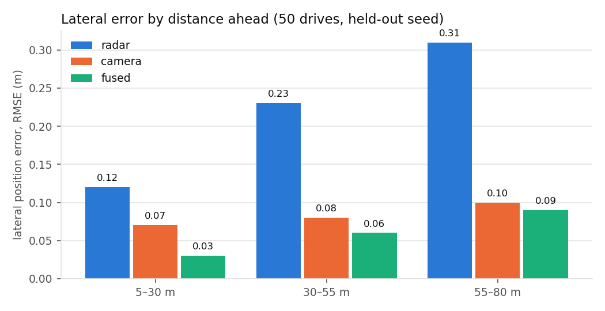

# Fusion Tracker

Multi-target tracking of highway traffic from simulated radar and camera data, in C++17 with no
external dependencies. An extended Kalman filter per vehicle, global nearest neighbour data
association with the Hungarian algorithm, and track management, evaluated against ground truth
over many simulated drives.



## Why fuse

The two sensors fail in opposite ways:

| | Radar | Mono camera |
|---|---|---|
| Range | 0.25 m noise | Grows with distance: about 1 m at 20 m, 6.5 m at 80 m |
| Bearing | 1° noise, so 1.4 m sideways at 80 m | 0.15° noise |
| Range rate | 0.1 m/s | Not measured |
| Field of view | ±40°, up to 160 m | ±30°, up to 90 m |
| Rate | 20 Hz | 15 Hz, not synchronised with radar |

Radar knows how far away a car is but not exactly which lane it is in; the camera knows the
direction but not the distance. Fusing both should give accurate positions in both directions.

## Results

50 simulated drives of 60 s each (seed 2, not used for tuning). Every sensor setup tracks the
same drives with the same measurements, and is scored in the area both sensors cover
(5–80 m ahead, within 28°).

| Setup | Along-road error | Lateral error | Velocity error | NEES | False tracks | ID switches |
|---|---:|---:|---:|---:|---:|---:|
| Radar only | 0.05 m | 0.23 m | 0.25 m/s | 3.4 | 0.03 | 1.8 /min |
| Camera only | 1.16 m | 0.09 m | 1.16 m/s | 4.0 | 0.08 | 1.0 /min |
| **Fused** | **0.06 m** | **0.07 m** | 0.27 m/s | 3.8 | 0.20 | 3.2 /min |

- Fused lateral error was lower than radar-only in **50 of 50** drives, and fused along-road error
  lower than camera-only in **50 of 50**.
- **NEES** (normalised estimation error squared) checks that the filter's own uncertainty matches
  its real errors. For a 4-dimensional state it should average 4; all setups are close.
- **False tracks** is the average number of confirmed tracks not following any car.
- **The cost of fusion:** fused tracking has more false tracks and ID switches than radar alone,
  and slightly worse velocity. I have not isolated the cause yet; likely parts are the camera's
  own false detections and the extra association decisions per second. Lane assignment was above
  99.5% in every setup, so the lateral gain matters for precision, not for basic lane assignment.


Beyond 90 m only the radar sees the cars, so tracks get noisier sideways.

## What went wrong on the way

The first working version looked fine on accuracy but had several problems. Finding them was
most of the work.

1. **Cars drove through each other.** The traffic simulator had no car following, so 45% of the
   time a car had another within 8 m, and tracks swapped between them. Cars now use the
   Intelligent Driver Model and only change lanes into a gap. With the same filter settings,
   fused NEES dropped from 9.5 to 3.5: the filter had been blamed for traffic that could not
   happen.
2. **My evaluation counted the wrong things.** Matching tracks to cars within a 4 m circle let a
   track in the next lane (3.5 m away) count as correct. Matching now allows 4 m along the road
   but only 1.5 m across it.
3. **Clutter created duplicate tracks.** A false radar return next to a real car started a track
   with a random velocity. The camera cannot measure velocity and has a wide range uncertainty,
   so its detections kept that track alive while radar fed the real one. Two fixes:
   - New tracks start with a velocity prior that allows ±10 m/s along the road but only ±1.5 m/s
     across it, and the radar range rate is applied as a proper Kalman update.
   - Tracks whose positions are statistically the same (Mahalanobis distance below the 99% point)
     are merged, keeping the older one.

   Effect of merging on the held-out seed, fused setup:

   | | False tracks | ID switches |
   |---|---:|---:|
   | Without merging | 0.87 | 24.0 /min |
   | With merging | 0.20 | 3.2 /min |

4. **Tuning on the test data.** The motion noise was chosen on seed 1 so that NEES is close to 4
   (2.5 m/s² along the road, 1.0 m/s² across it). All numbers above come from seed 2.

## How it works

| Part | File | Notes |
|---|---|---|
| Traffic | `src/traffic.cpp` | Three lanes, IDM car following, random speed changes, lane changes into gaps, cars entering and leaving |
| Sensors | `src/sensors.cpp` | Polar measurements, field of view, detection probability, Poisson clutter |
| Filter | `src/ekf.cpp` | Constant-velocity EKF, separate along-road and lateral process noise, analytic Jacobians, Joseph-form update |
| Association | `src/assignment.cpp` | Chi-square gating, Hungarian algorithm with a cost for leaving a track or detection unassigned |
| Tracks | `src/tracker.cpp` | 3-of-5 confirmation over scans that could see the track, deletion after 1 s without updates, duplicate merging |
| Scoring | `src/metrics.cpp` | Truth-to-track matching, RMSE, NEES, lane accuracy, false tracks, ID switches |
| Matrices | `include/fusion/matrix.hpp` | Fixed-size templates, enough for 4×4. Eigen would be the choice in production |

Measurements are processed one sensor scan at a time, in time order, so the 20 Hz radar and 15 Hz
camera need no synchronisation.

## Build and run

```bash
cmake -S . -B build -DCMAKE_BUILD_TYPE=Release
cmake --build build -j
ctest --test-dir build --output-on-failure
```

```bash
./build/fusion_eval --runs 50 --seed 2
./build/fusion_eval --runs 50 --seed 2 --no-prune
./build/fusion_eval --runs 20 --seed 1 --q-long 4 --q-lat 1.5 --csv out/runs.csv
```

The figures come from `tools/plot_results.py` (needs matplotlib).

The tests cover the matrix inverse, the Hungarian algorithm against brute force, the radar
Jacobian against finite differences, filter consistency on a constant-velocity target (NEES near
4), sensor field of view, car spacing in the simulator, duplicate merging, reproducibility, and
that fusion beats each single sensor where that sensor is weak.

## Limitations

- Simulated data only. The sensor models are simplified and the numbers say nothing about a real
  radar or camera.
- No occlusion: a car hidden behind another is still detected.
- Constant-velocity model only. An interacting multiple model filter (constant velocity plus
  constant turn) would handle lane changes better.
- Global nearest neighbour makes hard decisions. JPDA or MHT would handle close cars better, at a
  higher cost.
- No sensor latency or out-of-sequence measurements, and sensors are perfectly calibrated.
- The ego drives straight at constant speed, so there is no ego-motion compensation.
- Very rarely, a car entering 50 m behind the ego overlaps another. That is outside every sensor's
  view and does not affect the results.
