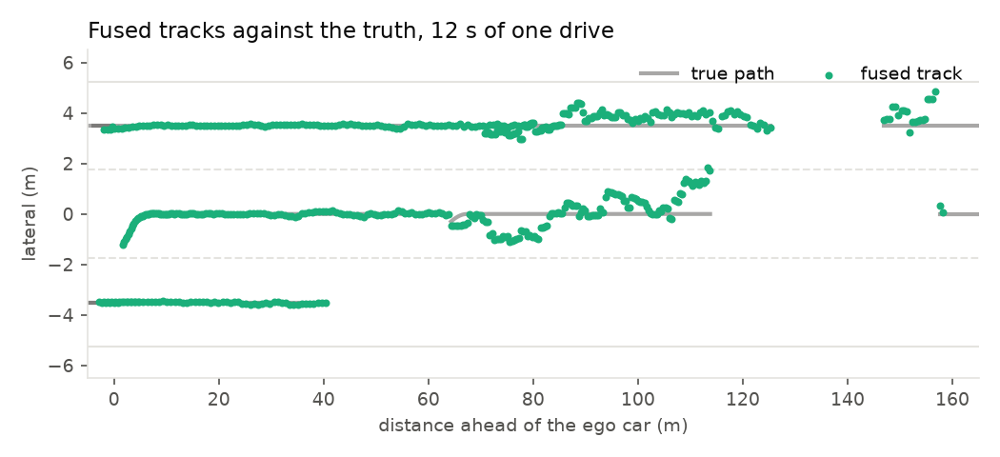

# Fusion Tracker

Multi-target tracking of highway traffic from simulated radar and camera data, in C++17 with no
external dependencies. An extended Kalman filter per vehicle, global nearest neighbour data
association with the Hungarian algorithm, and track management, evaluated against ground truth
over many simulated drives.


## Why fuse

The two sensors fail in opposite ways:

| | Radar | Mono camera |
|---|---|---|
| Range | 0.25 m noise | Grows with distance: about 1 m at 20 m, 6.5 m at 80 m |
| Bearing | 1° noise, so 1.4 m sideways at 80 m | 0.15° noise |
| Range rate | 0.1 m/s | Not measured |
| Field of view | ±40°, up to 160 m | ±30°, up to 90 m |
| Rate | 20 Hz | 15 Hz, not synchronised with radar |

Radar knows how far away a car is but not exactly which lane it is in; the camera knows the
direction but not the distance. Fusing both should give accurate positions in both directions.

## Results

50 simulated drives of 60 s each (seed 2, not used for tuning). Every sensor setup tracks the
same drives with the same measurements, and is scored in the area both sensors cover
(5–80 m ahead, within 28°). Nearer cars hide farther ones (see [Occlusion](#occlusion)).

| Setup | Along-road error | Lateral error | Velocity error | NEES | Cars tracked | False tracks | ID switches |
|---|---:|---:|---:|---:|---:|---:|---:|
| Radar only | 0.06 m | 0.27 m | 0.26 m/s | 3.3 | 99.8% | 0.01 | 1.1 /min |
| Camera only | 1.12 m | 0.09 m* | 1.70 m/s | 3.8 | 80.7% | 0.06 | 6.3 /min |
| **Fused** | **0.06 m** | **0.20 m** | 0.29 m/s | 3.7 | 99.6% | 0.05 | 2.0 /min |

\* The camera's errors only cover the cars it can see. It loses most hidden cars, which are the
hard ones, so its lateral error is not comparable with the other rows.

- Fused lateral error was lower than radar-only in **50 of 50** drives, and fused along-road error
  lower than camera-only in **50 of 50**.
- **NEES** (normalised estimation error squared) checks that the filter's own uncertainty matches
  its real errors. For a 4-dimensional state it should average 4; all setups are close.
- **False tracks** is the average number of confirmed tracks not following any car.
- **What fusion still costs:** fused tracking has more false tracks and ID switches than radar
  alone, because it inherits the false tracks that the camera's clutter creates.
  Fusion-specific false tracks were fixed (see point 5 below). Lane assignment was above 99.4% in
  every setup.
- **Time to track** was close to zero for radar and fused tracking: radar picks cars up far beyond
  the scored area, so stricter confirmation rules cost nothing here.

Without occlusion (`--no-occlusion`, the setup of the first versions) fused tracking reached
0.07 m lateral error, against 0.23 m for radar alone.



Beyond 90 m only the radar sees the cars, so tracks get noisier sideways. The car in the centre
lane between 65 and 115 m is hidden behind a nearer car, so the camera cannot see it and its track
wanders by up to a metre.

## Occlusion

A car hidden behind a nearer one is invisible to the camera. Radar still gets occasional returns
that bounce under the car in front, modelled as a 30% detection chance instead of 90%. A car
counts as hidden when nearer cars cover more than half of its width as seen from the ego. On the
held-out seed that is true for 21% of the time cars spend in the scored area.

Splitting the errors by visibility shows where the fused lateral error comes from:

| Setup | Lateral error, visible cars | Lateral error, hidden cars | Hidden cars tracked |
|---|---:|---:|---:|
| Radar only | 0.22 m | 0.42 m | 99.2% |
| Camera only | 0.09 m | 0.17 m | 18.5% |
| Fused | **0.07 m** | 0.42 m | 98.1% |

For cars it can see, fusion is as accurate as before. For hidden cars it falls back to radar,
whose sideways error at 60–70 m is large, and the error grows the longer a car stays hidden
(on the development seed, 0.16 m in the first half second and 0.5 m after 2.5 s). Lowering the lateral process noise did
not help hidden cars and broke NEES, so this is a sensing limit, not a tuning problem.

**What I tried: occlusion-aware coasting.** If a missed track is predicted to be behind a nearer
confirmed track, the miss is not counted and the track is kept for up to 3 s instead of 1 s
(`--occlusion-coasting`). On the held-out seed:

| | Camera ID switches | Camera, hidden cars tracked | Fused along-road error | Fused velocity error | Fused ID switches |
|---|---:|---:|---:|---:|---:|
| Off (default) | 6.3 /min | 18.5% | 0.06 m | 0.29 m/s | 2.0 /min |
| On | 3.5 /min | 29.7% | 0.10 m | 0.34 m/s | 2.1 /min |

It nearly halves ID switches for a camera-only tracker, which loses hidden cars completely. For
fused tracking it made things slightly worse: radar keeps hidden tracks alive anyway, and the
longer-coasting tracks drift and pick up wrong detections. It stays off by default. A coast time
of 1.5 or 2 s gave the same picture on the development seed.

## What went wrong on the way

The first working version looked fine on accuracy but had several problems. Finding them was
most of the work. The numbers in this section were measured before occlusion was modelled.

1. **Cars drove through each other.** The traffic simulator had no car following, so 45% of the
   time a car had another within 8 m, and tracks swapped between them. Cars now use the
   Intelligent Driver Model and only change lanes into a gap. With the same filter settings,
   fused NEES dropped from 9.5 to 3.5: the filter had been blamed for traffic that could not
   happen.
2. **My evaluation counted the wrong things.** Matching tracks to cars within a 4 m circle let a
   track in the next lane (3.5 m away) count as correct. Matching now allows 4 m along the road
   but only 1.5 m across it.
3. **Clutter created duplicate tracks.** A false radar return next to a real car started a track
   with a random velocity. The camera cannot measure velocity and has a wide range uncertainty,
   so its detections kept that track alive while radar fed the real one. Two fixes:
   - New tracks start with a velocity prior that allows ±10 m/s along the road but only ±1.5 m/s
     across it, and the radar range rate is applied as a proper Kalman update.
   - Tracks whose positions are statistically the same (Mahalanobis distance below the 99% point)
     are merged, keeping the older one.

   Effect of merging on the held-out seed, fused setup:

   | | False tracks | ID switches |
   |---|---:|---:|
   | Without merging | 0.71 | 22.6 /min |
   | With merging | 0.07 | 1.8 /min |

4. **Tuning on the test data.** The motion noise was chosen on seed 1 so that NEES is close to 4
   (2.5 m/s² along the road, 1.0 m/s² across it). All numbers above come from seed 2.
5. **Fusion added false tracks of its own.** The first published version had 0.20 false tracks and
   3.2 ID switches a minute when fused, against 0.03 and 1.8 for radar alone. Sorting every false
   track by how it started and what fed it showed that most began as radar clutter and were then
   confirmed by camera detections of a real car nearby. The camera's range is so uncertain at
   distance that such a detection can fall inside the clutter track's gate. A track now counts hits
   and misses for confirmation only from the sensor that started it; other sensors still update
   it. On the held-out seed, fused setup:

   | | False tracks | ID switches | Velocity error |
   |---|---:|---:|---:|
   | Any sensor confirms | 0.20 | 3.2 /min | 0.27 m/s |
   | Starting sensor confirms | 0.07 | 1.8 /min | 0.21 m/s |

   On the development seed the velocity error moved the other way (0.25 to 0.29 m/s), so I do not
   claim a velocity gain. A stricter 4-of-6 rule (`--confirm 4 6`) cuts false tracks further for
   radar and fused tracking, but on the development seed it raised fused along-road error from 0.05 to 0.09 m,
   so the default stays 3-of-5.

## How it works

| Part | File | Notes |
|---|---|---|
| Traffic | `src/traffic.cpp` | Three lanes, IDM car following, random speed changes, lane changes into gaps, cars entering and leaving |
| Sensors | `src/sensors.cpp` | Polar measurements, field of view, detection probability, Poisson clutter, occlusion by nearer cars |
| Filter | `src/ekf.cpp` | Constant-velocity EKF, separate along-road and lateral process noise, analytic Jacobians, Joseph-form update |
| Association | `src/assignment.cpp` | Chi-square gating, Hungarian algorithm with a cost for leaving a track or detection unassigned |
| Tracks | `src/tracker.cpp` | 3-of-5 confirmation by the sensor that started the track, over scans that could see it; deletion after 1 s without updates; duplicate merging; optional occlusion-aware coasting |
| Scoring | `src/metrics.cpp` | Truth-to-track matching, RMSE, NEES, lane accuracy, false tracks, ID switches, time to track, errors split by visibility |
| Matrices | `include/fusion/matrix.hpp` | Fixed-size templates, enough for 4×4. Eigen would be the choice in production |

Measurements are processed one sensor scan at a time, in time order, so the 20 Hz radar and 15 Hz
camera need no synchronisation.

## Build and run

```bash
cmake -S . -B build -DCMAKE_BUILD_TYPE=Release
cmake --build build -j
ctest --test-dir build --output-on-failure
```

```bash
./build/fusion_eval --runs 50 --seed 2
./build/fusion_eval --runs 50 --seed 2 --no-prune
./build/fusion_eval --runs 50 --seed 2 --any-sensor-confirms
./build/fusion_eval --runs 50 --seed 2 --confirm 4 6
./build/fusion_eval --runs 50 --seed 2 --no-occlusion
./build/fusion_eval --runs 50 --seed 2 --occlusion-coasting
./build/fusion_eval --runs 20 --seed 1 --q-long 4 --q-lat 1.5 --csv out/runs.csv
```

The figures come from `tools/plot_results.py` (needs matplotlib).

The tests cover the matrix inverse, the Hungarian algorithm against brute force, the radar
Jacobian against finite differences, filter consistency on a constant-velocity target (NEES near
4), sensor field of view, occlusion geometry, that the camera cannot see a hidden car, that
occlusion coasting keeps a hidden track, car spacing in the simulator, duplicate merging, that camera hits alone
cannot confirm a radar clutter track, reproducibility, and
that fusion beats each single sensor where that sensor is weak.

## Limitations

- Simulated data only. The sensor models are simplified and the numbers say nothing about a real
  radar or camera.
- Occlusion is 2D geometry with boxes of one size. Trucks, height and the 30% radar detection
  rate behind a car are assumptions, not measurements.
- Constant-velocity model only. An interacting multiple model filter (constant velocity plus
  constant turn) would handle lane changes better.
- Global nearest neighbour makes hard decisions. JPDA or MHT would handle close cars better, at a
  higher cost.
- No sensor latency or out-of-sequence measurements, and sensors are perfectly calibrated.
- The ego drives straight at constant speed, so there is no ego-motion compensation.
- Very rarely, a car entering 50 m behind the ego overlaps another. That is outside every sensor's
  view and does not affect the results.
